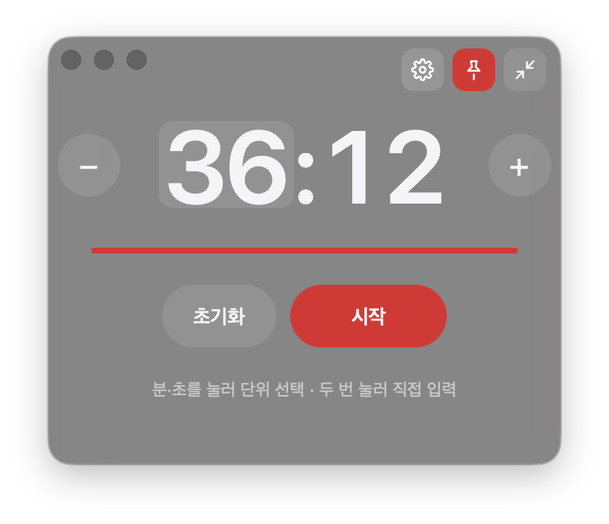
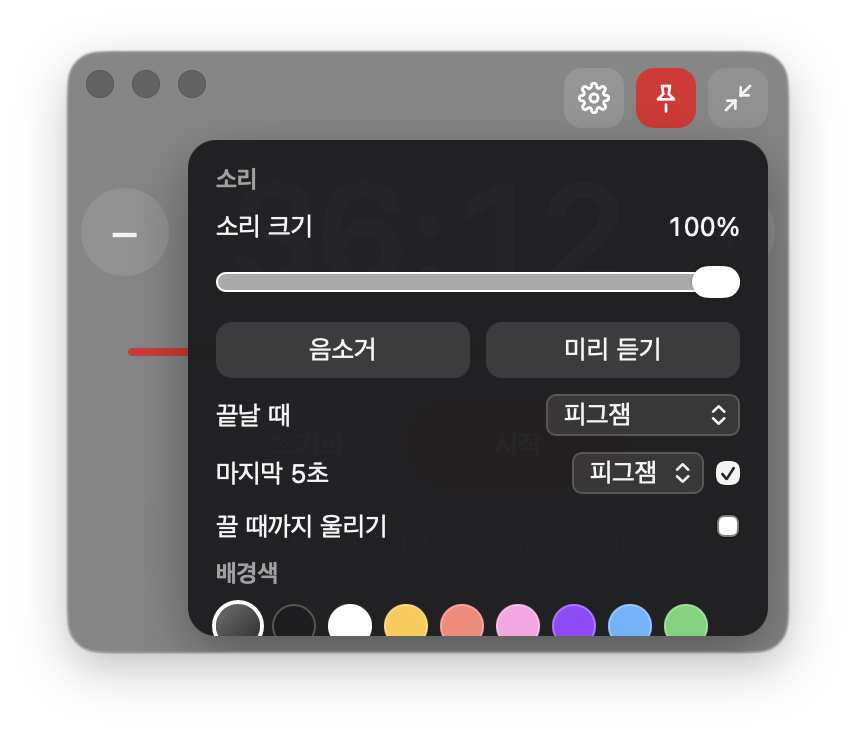
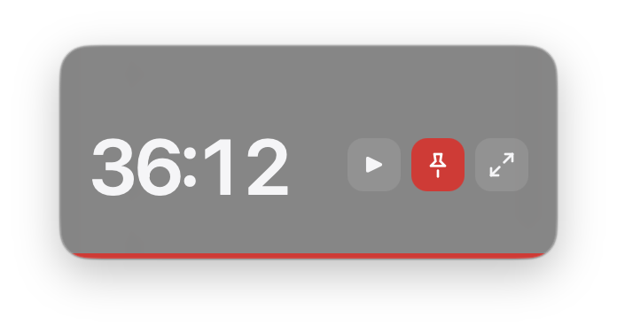

<div align="center">


# 타이머

**화면 구석에 띄워 두는 작고 깔끔한 맥 타이머**

[](https://github.com/kimkh0118/timer/releases/latest)


&nbsp;&nbsp;



</div>

---

## ✨ 이런 걸 할 수 있어요

- ⏱️ **−/+ 한 번으로 시간 맞추기** — 기본 5분, 분·초를 눌러 단위를 고르고 길게 누르면 쭉
- 📌 **항상 위에 고정** — 다른 앱, 전체 화면 위에도 떠 있어요
- 🔎 **작게 보기** — 화면 구석에 손바닥만 하게
- 🔔 **마지막 5초 카운트다운 + 끝 소리** — 피그잼 소리 기본, 9가지 + 맥 기본 소리 + 내 소리 파일
- 🎨 **배경색 바꾸기** — 유리(기본)·8가지 색·직접 고르기
- 🎯 **정확한 알람** — 창이 가려져 있거나 다른 앱을 써도 제시간에 울려요

---

## 📥 설치하기

### 방법 1. 한 줄로 설치 (가장 쉬워요, 추천)

1. **Spotlight(⌘ 스페이스)** 에서 `터미널`을 열어요.
2. 아래 한 줄을 복사해서 붙여 넣고 Enter를 눌러요.

```bash
curl -fsSL https://raw.githubusercontent.com/kimkh0118/timer/main/install.sh | bash
```

끝이에요. 최신 버전을 응용 프로그램 폴더에 설치하고 바로 실행해요.
이 방법은 **"확인되지 않은 개발자" 경고 없이** 바로 열려요. 다시 실행하면 최신 버전으로 업데이트돼요.

### 방법 2. 설치 파일(DMG)로 설치

1. **[Timer.dmg 다운로드](https://github.com/kimkh0118/timer/releases/latest/download/Timer.dmg)** 를 눌러 받아요. GitHub 계정은 필요 없어요.
2. 받은 `Timer.dmg`를 더블 클릭하고, `타이머.app`을 옆의 **Applications** 폴더로 끌어다 놓아요.
3. 응용 프로그램 폴더에서 **타이머**를 열어요.

<details>
<summary><b>"Apple은 '타이머'에 악성 코드가 없음을 확인할 수 없습니다"가 뜨면</b></summary>

<br>

이 앱은 Apple 유료 공증을 받지 않아서 처음 한 번은 막혀요. 아래처럼 한 번만 허용하면 다음부터는 그냥 열려요.

1. 경고 창에서 **완료**를 눌러요. (휴지통으로 이동 ❌)
2. **시스템 설정 → 개인정보 보호 및 보안**을 열어요.
3. 아래쪽 **보안**에서 타이머 옆의 **그래도 열기**를 눌러요.
4. 암호를 입력하고, 한 번 더 **열기**를 눌러요.

학교·회사에서 관리하는 맥은 관리자가 막아 둘 수 있어요. 자세한 건 [Apple 공식 안내](https://support.apple.com/ko-kr/102445)를 보세요.

</details>

### 업데이트 · 지우기

- **업데이트**: 방법 1의 한 줄을 다시 실행하거나, 새 DMG로 덮어쓰면 돼요.
- **지우기**: 응용 프로그램 폴더에서 타이머를 휴지통으로 옮기거나, 터미널에서

```bash
curl -fsSL https://raw.githubusercontent.com/kimkh0118/timer/main/install.sh | bash -s -- --uninstall
```

---

## 📖 사용 설명서

### 기본

| 하고 싶은 일 | 이렇게 해요 |
| --- | --- |
| 시간 맞추기 | **−** / **+** 버튼 (1분씩). 길게 누르면 계속 바뀌어요 |
| 초 단위로 맞추기 | 시간의 **초** 부분을 한 번 눌러요 → −/+가 1초씩. **분**을 누르면 다시 1분씩 |
| 숫자로 바로 입력 | 시간을 **두 번 클릭**하거나 그냥 **숫자 키**를 치고 Enter |
| 시작 / 일시정지 | **시작** 버튼 또는 **스페이스바** |
| 도는 중에 시간 더하기 | **+** 버튼 (고른 단위만큼) |
| 처음으로 | **초기화** 버튼 또는 **R** |
| 알람 끄기 | **알람 끄기** 버튼, 스페이스바 또는 **Esc** |

**숫자 입력 예시**: `7` → 7분 · `130` → 1분 30초 · `10:30` → 10분 30초 · `1:05:00` → 1시간 5분

### 오른쪽 위 버튼

| 버튼 | 하는 일 |
| --- | --- |
| ⚙️ 설정 | 소리 크기·음소거·미리 듣기, 끝 소리, 마지막 5초 소리, 반복, 배경색, 내 소리 파일 |
| 📌 고정 | 켜면(빨간색) 다른 앱·전체 화면 위에도 항상 떠 있어요 |
| ↙ 작게 보기 | 화면 오른쪽 위에 작은 창으로. 작은 창의 ↗ 버튼으로 다시 크게 |

### 소리

- **마지막 5초**: 피그잼 / 똑~딱 / 삑 중에서 고르고, 체크를 끄면 조용해요.
- **끝날 때**: 피그잼 · 뜨드뜨드든 · 마림바 · 삐비비비 · 벨 · 디지털 알람 · 실로폰 · 딩동 · 맥 기본 소리 11가지 · 내 소리 파일
- **끌 때까지 울리기**: 켜 두면 알람을 끌 때까지 계속 울려요.
- **내 소리 파일 넣기**: 설정 맨 아래에서 mp3·wav·m4a(3MB 이하)를 고르면 돼요. `기본`을 누르면 원래 소리로.
- 소리 크기는 맥 전체 음량과 따로 조절돼요.

### 키보드 단축키

| 키 | 동작 |
| --- | --- |
| `스페이스` | 시작 / 일시정지 / 알람 끄기 |
| `↑` `↓` | 고른 단위만큼 더하기 / 빼기 |
| `←` `→` | 분 / 초 단위 고르기 |
| `0`–`9` | 바로 숫자 입력 |
| `R` | 초기화 |
| `Esc` | 알람 끄기 · 설정 닫기 · 입력 취소 |
| `⌘0` | 닫은 창 다시 열기 |
| `⌘Q` | 종료 |

### 알아 두면 좋아요

- 창을 닫아도 앱은 켜져 있어요(Dock에 남은 시간 표시). 완전히 끄려면 `⌘Q`.
- 설정은 자동으로 저장돼서 다음에 켜도 그대로예요.

---

## ❓ 자주 묻는 질문

<details>
<summary>소리가 안 나요</summary>

설정에서 소리 크기가 0%이거나 **음소거**가 켜져 있는지 확인해요. 맥 전체 음량과 출력 장치(이어폰 등)도 확인해 주세요. **미리 듣기**로 바로 시험할 수 있어요.
</details>

<details>
<summary>창이 사라졌어요</summary>

Dock의 타이머 아이콘을 누르거나 `⌘0`을 눌러요.
</details>

<details>
<summary>Windows에서도 되나요?</summary>

아니요, 맥 전용이에요 (macOS 11 이상, Apple Silicon·Intel 모두 지원).
</details>

---

## 🛠 직접 빌드하기

Xcode 명령줄 도구가 필요해요 (`xcode-select --install`).

```bash
git clone https://github.com/kimkh0118/timer.git
cd timer
./build.sh --install   # 빌드해서 바탕화면에 설치하고 실행
./build.sh --package   # 배포용 build/Timer.dmg, build/Timer.zip 만들기
```

- 화면: `app/Resources/index.html` · 맥 기능(창 고정, 알람, 소리): `src/main.swift`
- 소리 테스트: `node tests/audio.test.cjs`
- 아이콘 다시 만들기: `swift tools/make-icon.swift`

## 🔊 음원 출처

피그잼 원본 음원(Figma)을 증폭해 사용했어요. 음원 권리는 원저작권자에게 있습니다.
- 마지막 5초: https://static.figma.com/uploads/54a944bea3fce3ca45c91429993683685bec5782
- 종료음: https://static.figma.com/uploads/f45e11344ee4f618173695e2405a9a988affc910

그 밖의 소리(뜨드뜨드든·마림바·벨 등)는 앱 안에서 직접 합성해요.
